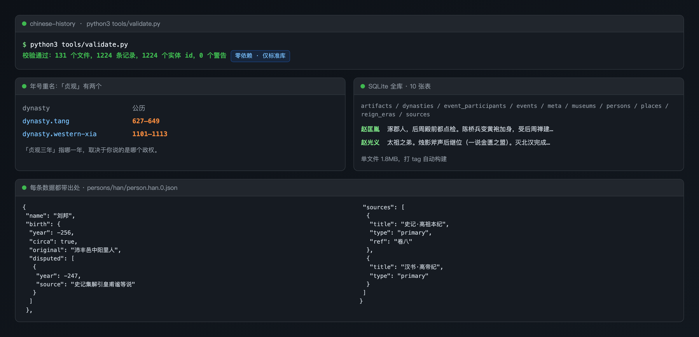

<div align="center">

# chinese-history 📜

### 人物 · 事件 · 文物：中华历史的开源结构化数据库

370 位历史人物（94% 已对齐 Wikidata QID） · 162 个历史事件 · **3327 件馆藏文物**（大都会 + 克利夫兰 3308 件 CC0 全量） · 551 个年号 · 49 个朝代/政权——全部 JSON 分发，clone 即用

[](https://github.com/anthonyhann/chinese-history/releases)
[](https://github.com/anthonyhann/chinese-history/releases/latest)
[](https://github.com/anthonyhann/chinese-history/releases/latest)
[](#-数据集)
[](https://github.com/anthonyhann/chinese-history/actions/workflows/validate.yml)

[](LICENSE-CODE)
[](LICENSE-DATA)
[](LICENSE-DATA)

[🚀 快速开始](#-快速开始) · [📦 数据集](#-数据集) · [📐 Schema](schema/) · [🤝 贡献](CONTRIBUTING.md) · [💬 Discussions](https://github.com/anthonyhann/chinese-history/discussions) · [English](README.en.md) · [llms.txt](llms.txt)

</div>

---

> 灵感来自 [chinese-poetry](https://github.com/chinese-poetry/chinese-poetry)：古诗词有了最全的开源数据库，历史也该有一个。
>
> 但历史比诗词难做得多——生卒年在争、纪年要换算、出处要考证。所以本项目把**「出处」做成一等公民**：没有 `sources` 的记录过不了 CI，学术争议不投票而是多值并存，每条 AI 生成的数据都留了模型和 prompt 版本。
>
> **一句话定位**：给开发者和 AI Agent 用的一份干净的中华历史结构化数据，clone 即用，不用爬百科、不用担心版权。

### ▶ [**直接在线试用，不用装任何东西**](https://anthonyhann.github.io/chinese-history/)

搜一个人名、拖一条时间轴，30 秒就能看懂这个库装了什么。

**不想 clone？** 直接下载单文件数据库 → [最新 Release](https://github.com/anthonyhann/chinese-history/releases/latest)（SQLite 1.8MB 全库 / JSON zip）

**想先看设计思路？** 三条铁律为什么这么定、各自付出了什么代价 → [《给中华历史数据建 Schema 时，我踩的三个坑和付出的代价》](https://juejin.cn/post/7700407749293768739)

[](https://anthonyhann.github.io/chinese-history/)

---

**如果这个项目对你有用，点个 ⭐ Star 是最实际的帮助。** 它不会让数据变得更准，但决定了这个库能不能被更多需要它的人看见——也是我能不能找到 co-maintainer 的前提。

当前需要帮忙的具体位置：[`disputed[]` 争议多值目前只覆盖 9/370 人](https://github.com/anthonyhann/chinese-history/issues/4)，以及[还没有任何一条数据经过人工核验](https://github.com/anthonyhann/chinese-history/issues/5)。你熟悉哪段历史，就带着书目来提 PR，一条一个 PR，出处要能核。长期共建见 [#6 招募 co-maintainer](https://github.com/anthonyhann/chinese-history/issues/6)。

## ⚖️ 对比已有的方案：它解决什么问题

| 你现在的做法 | 卡在哪 | 这个项目 |
|---|---|---|
| 翻维基百科手抄 | 结构不统一，只能一条条抄 | JSON 分片，字段固定，`clone` 即用 |
| 爬百度百科 | 有版权风险，改版就挂 | 事实数据 CC0，描述文本原创（CC BY-SA） |
| 用 [CBDB](https://cbdb.fas.harvard.edu/) | 学术级，格式重，面向学者 | 面向开发者，跑一遍 `validate.py` 就明白结构 |
| 问 AI | 会编，编了你看不出来 | 每条带 `sources`，AI 生成的记录在 `_meta` 里记了模型和 prompt 版本 |
| 自己做一份 | 生卒年争议、年号换算全是坑 | 551 条年号表 + `disputed[]` 多值 + 时间双轨 |

**和 [chinese-poetry](https://github.com/chinese-poetry/chinese-poetry) 的关系**：它证明了「JSON 分发的开放数据」这条路在古诗词领域走得通。历史数据不能照搬那套做法，因为历史给的是**断言**而不是文本，每条背后都有「据某书卷几」，而这些书之间经常互相矛盾。

**要说清楚它不是什么**：

- 不是学术库，深度比不上 CBDB
- 不存二十四史全文，只存结构化事实
- 目前**没有任何一条数据经过逐条人工核验**，用前请自己核对 `sources`

## 📖 长这样

```json
{
  "id": "person.qin.yingzheng",
  "name": "嬴政",
  "titles": ["秦始皇", "始皇帝"],
  "birth": {"year": -259, "original": "秦昭襄王四十八年正月"},
  "reign": {"start": -247, "end": -210},
  "successor": "person.qin.huhai",
  "sources": [{"title": "史记·秦始皇本纪", "type": "primary", "ref": "卷六"}]
}
```

一行命令查数据：

```bash
jq '.[] | select(.titles[]? | contains("秦始皇"))' persons/qin/person.qin.0.json
```

## 🎯 能拿它做什么

四个已经跑通的场景，每条命令都基于仓库现有数据：

**① 查一个人牵连的所有事件**
以刘邦为例，跨 `persons/` 和 `events/` 两个目录关联：

```python
import json, glob
for f in glob.glob("events/**/*.json", recursive=True):
    for e in json.load(open(f)):
        if any(p["person"] == "person.han.liubang" for p in e.get("participants") or []):
            print(e["name"], e["time"]["start"], e["time"]["original"])
```

→ 刘邦入关子婴投降（前206，汉元年十月）、楚汉战争（前206–前202）、白登之围（前200，汉高祖七年）

**② 年号换算公历（注意重名）**
「贞观」有两个，唐太宗的和西夏崇宗的：

```python
import json, glob
for f in glob.glob("reign_eras/*.json"):
    for r in json.load(open(f)):
        if r["name"] == "贞观":
            print(r["dynasty"], r["start"], "-", r["end"])
```

→ `dynasty.tang 627-649` / `dynasty.western-xia 1101-1113`

**这个例子本身就是设计理由**：史料里的「贞观三年」到底指哪一年，取决于你在讲哪个政权。想当然地映射过去就会错。

**③ 查一个人的在位时间与备注**

```python
import json
for r in json.load(open("persons/qin/person.qin.0.json")):
    if "秦始皇" in (r.get("titles") or []):
        print(r["reign"])
```

→ `{'start': -247, 'end': -210, 'note': '前247年即位为秦王（时年十三），前238年亲政，前221年统一六国称始皇帝'}`

注意 `reign.start` 是 **-247（即位为秦王）**，不是 -221（称帝）。这两个日期都真实存在，取哪个取决于你要回答什么问题。

**④ 建一个帝王世系树**
`predecessor` / `successor` 构成完整链条，从秦始皇一路可追到溥仪退位：

```bash
jq -r '.[] | "\(.name) → \(.successor // "（终）")"' persons/qing/person.qing.0.json
```

想直接查 SQL？先 `python3 tools/build_sqlite.py`，再打开 `dist/chinese-history.sqlite`，7 张表（persons / events / artifacts / dynasties / reign_eras / places / museums）都已建好。

## 🚀 快速开始

**只是想看看数据长什么样** → [在线 demo](https://anthonyhann.github.io/chinese-history/)（搜索 / 时间轴 / 文物画廊，纯静态无后端）

**3 步，零依赖（仅 Python 标准库）：**

```bash
git clone https://github.com/anthonyhann/chinese-history.git  # ① 拿数据
cd chinese-history
python3 tools/validate.py                                     # ② 验证数据完整性（4497 条）
jq '.[] | .name' persons/han/person.han.0.json                # ③ 开始用（或任何语言的 JSON 库）
```

**给你的 AI Agent 用**（把这句话粘贴给它）：

> 请阅读 https://github.com/anthonyhann/chinese-history/blob/master/llms.txt ，了解 chinese-history 的结构与 Schema 后，帮我基于它的数据构建应用。

## 📦 数据集

每条数据必带出处（`sources`），无出处无法通过 CI——这是本仓库与"AI 内容农场"的分界线。

| 数据集 | 记录数 | 状态 |
|---|---:|---|
| [人物 · 秦](persons/qin/) | 18 | ✅ M1 种子 |
| [人物 · 汉](persons/han/) | 31 | ✅ M2 已放量（两汉全部帝系） |
| [人物 · 魏晋南北朝](persons/) | 86 | ✅ v0.2.0（魏/蜀/吴/两晋/十六国/南北朝） |
| [人物 · 隋唐五代](persons/) | 39 | ✅ v0.3.0（隋 4/唐 21 含武则天/五代 14） |
| [人物 · 宋辽金](persons/) | 37 | ✅ v0.4.0（北宋 9/南宋 9/辽 9/金 10） |
| [人物 · 元明清](persons/) | 43 | ✅ v1.0.0（帝系贯通至 1912） |
| [人物 · 十国/西夏/大理](persons/) | 34 | ✅ v1.1.0（帝系拼图补齐） |
| [人物 · 名臣将相](persons/) | 82 | ✅ 两批（商鞅/白起/诸葛亮/魏征/李白/王安石/苏轼/岳飞/于谦/王阳明/曾国藩/林则徐等） |
| [事件 · 秦](events/qin/) | 23 | ✅ M1 种子（+ 商鞅变法/商鞅车裂/长平之战） |
| [事件 · 汉](events/han/) | 20 | ✅ M2 新增（+ 文景之治） |
| [事件 · 魏晋南北朝](events/) | 33 | ✅ v0.2.0（官渡/赤壁/淝水/侯景等） |
| [事件 · 隋唐五代](events/) | 25 | ✅ v0.3.0（大运河/玄武门/贞观/安史之乱等，+ 租庸调制） |
| [事件 · 宋辽金](events/) | 26 | ✅ v0.4.0（陈桥兵变/澶渊之盟/靖康之变/崖山等） |
| [事件 · 元明清](events/) | 35 | ✅ v1.0.0（蒙古西征/郑和下西洋/鸦片战争/辛亥革命，+ 一条鞭法/摊丁入亩/土木之变） |
| [文物 · 秦陵博物院](artifacts/qin/) | 1 | 🔬 Schema 样例 |
| [文物 · 大都会博物馆](artifacts/met/) | 892 | ✅ M3 全量（中国藏品公有领域 + CC0 图片全库拉取） |
| [文物 · 史密森尼亚洲艺术馆](artifacts/smithsonian/) | 15 | ✅ v1.2.0（商周青铜/玉器/唐俑，CC0） |
| [文物 · 大英博物馆](artifacts/british-museum/) | 3 | ✅ v1.3.0（NC 许可仅链接） |
| [文物 · 克利夫兰](artifacts/cleveland/) | 2416 | ✅ M3 全量（中国艺术部 CC0 藏品 + 图片全库拉取） |
| [朝代/政权](dynasties/) | 49 | ✅ 基础表 |
| [年号纪年](reign_eras/) | 551 | ✅ 秦汉至明清 + 十国西夏（建元 → 宣统） |
| [地名](places/) | 31 | ✅ 含今地名与坐标 |
| [博物馆](museums/) | 7 | ✅ 含各馆开放数据许可状态 |

## 📐 三个设计决策（与诗词库的关键差异）

1. **id 锚点第一天就有**：`person.qin.yingzheng` 可读 slug + UUID 双标识，人物/事件/文物/地名互相引用，发布即冻结，永不复用
2. **时间双轨制**：史料原文纪年（"秦始皇三十七年七月丙寅"）+ 归一化公历（`-210`）+ `circa` 约数 + `disputed[]` 学术争议多值并存——争议不投票，各标出处
3. **出处强制 + 生产可复现**：`sources` 为空直接过不了 CI；每条数据的生成模型与 prompt 版本记录在 `_meta`，可追溯、可重跑

## ⚠️ 什么时候别用它（诚实边界）

- **做学术研究/论文** → 请用 [CBDB](https://cbdb.fas.harvard.edu/) 等专业学术库。本库定位是开发者友好与中文优先，不是学术深度
- **需要经人工核验的可靠性** → 当前全部记录由 AI 流水线生成并做过部分抽查，**没有任何一条经过逐条人工核验**。`_meta` 记录的是生成模型与 prompt 版本（用于追溯），不是正确性保证。请以 `sources` 自行核对，纠错请提 PR
- **需要完整二十四史全文** → 我们只存结构化事实，不存史料全文

## 🗺️ 路线图

- ✅ **M0 基建**：Schema / CI 校验器 / 朝代·年号·地名·博物馆基础表
- ✅ **M1 秦朝冷启动**：3 帝 + 15 关联人物 + 20 事件
- ✅ **M2 汉代放量**：两汉 31 帝系 + 74 年号 + 19 个重大事件
- ✅ **M2.5 魏晋南北朝**：86 帝王 + 182 年号 + 12 重大事件
- ✅ **M2.6 隋唐五代**：39 帝王 + 95 年号 + 15 重大事件
- ✅ **M2.7 宋辽金**：37 帝王 + 100 年号 + 12 重大事件
- ✅ **v1.0.0 元明清**：43 帝王 + 46 年号 + 15 重大事件——帝系全程贯通（前221年–1912年）
- ✅ **v1.1.0 补全**：十国/西夏/大理 34 帝 + 名臣将相 41 人 + Met CC0 文物 24 件
- ✅ **v1.2.0 加密**：名臣第二批 41 人 + 事件加密 61 个 + Smithsonian CC0 文物 15 件
- ✅ **v1.3.0 对齐**：348/370 人物挂上 Wikidata QID + 大英博物馆文物 3 件
- ✅ **v1.4.0 馆藏通道**：克利夫兰 CC0 文物 19 件（当前）
- ✅ **M3 文物通道**：大都会中国公有领域藏品 892 件 + 克利夫兰中国艺术部 CC0 藏品 2416 件，全部带 CC0 图片直链（未发布，待 v1.5.0 打 tag）
  - **诚实说明**：这 3308 件里 972 件给出了中文名（其中 441 件是名称能确定性对译、如「瓶」「罐」「三足鼎」，531 件只对到器物类别、纹饰题材见 `name_en`），其余 2293 件保留博物馆原英文名——宁可留英文，不编中文名。跨馆重复与各馆断代口径不一致的问题见 [M3 说明书](docs/M3-ARTIFACTS.md)
- 🔜 **M3+**：SQLite 构建器已可用（`python3 tools/build_sqlite.py`），release 自动化见 `.github/workflows/release.yml`
- 🔜 **M4**：历代皇帝全量、案例展示

## 💬 参与进来

**最快的参与方式**：点 ⭐ Star。Star 数决定这个库能不能被更多需要它的人搜到，也是招募 co-maintainer 的前提。

**能直接贡献的**（都比想象中好上手）：

| 想做的事 | 怎么做 |
|---|---|
| 补一条有学术争议的生卒年 | 往 `disputed[]` 加一个带书目的值，一条一个 PR → [#4](https://github.com/anthonyhann/chinese-history/issues/4) |
| 核验一条现有数据 | 对着 `sources` 读原书，确认无误后告诉我们，这是当前最缺的 → [#5](https://github.com/anthonyhann/chinese-history/issues/5) |
| 补你家乡博物馆的中华文物 | 按 `artifacts/` 现有 Schema 添加，注意图片许可逐条标注 |
| 长期共建 | 数据校订 / 前端可视化 / 贡献流程，任一方向都欢迎 → [#6](https://github.com/anthonyhann/chinese-history/issues/6) |
| 用了这个数据做了东西 | 在 [Discussions](https://github.com/anthonyhann/chinese-history/discussions) 说一声，收录进案例展示 |

数据纠错 PR 请**注明出处**，无出处不合并，详见 [CONTRIBUTING.md](CONTRIBUTING.md)。

**有想法、有问题、或者只是想聊聊怎么用？** 去 [Discussions](https://github.com/anthonyhann/chinese-history/discussions) 比提 issue 更合适——那里可以自由讨论 Schema 设计、数据该存成什么样、你拿它做了什么。

## 📝 更新日志

- **2026-10-25** v1.4.0：克利夫兰 CC0 文物 19 件，实体总数 1224
- **2026-10-25** v1.3.0：Wikidata 对齐 94% + 大英博物馆文物 3 件，实体总数 1204
- **2026-10-24** v1.2.0：名臣第二批 41 + 事件加密 61 + Smithsonian 文物 15，实体总数 1201
- **2026-10-24** v1.1.0：十国/西夏/大理 34 帝 + 名臣将相 41 人 + Met 文物 24 件，实体总数 1084
- **2026-10-24** v1.0.0：元明清放量，实体总数 922，帝系全程贯通至 1912 年
- **2026-10-23** v0.4.0：宋辽金放量——37 位帝王、100 个年号、12 个重大事件，实体总数 815
- **2026-10-23** v0.3.0：隋唐五代放量——39 位帝王、95 个年号、15 个重大事件，实体总数 660
- **2026-10-23** v0.2.0：魏晋南北朝放量——86 位帝王、182 个年号、12 个重大事件，实体总数 503
- **2026-10-23** M2 补：汉代 19 个重大事件 + SQLite 构建器，实体总数 203
- **2026-10-23** M2：汉代 31 帝系人物 + 74 个年号入库，实体总数 179
- **2026-10-23** M0+M1：仓库骨架、CI 校验器、秦朝 18 人物 + 20 事件种子数据

## License

| 内容 | 许可 |
|---|---|
| 工具链代码 | [MIT](LICENSE-CODE) |
| 事实数据（年代、谱系、收藏地等） | [CC0](LICENSE-DATA) |
| 描述文本（bio/description，均为原创） | [CC BY-SA 4.0](LICENSE-DATA) |
| 文物图片 | 逐条标注源站许可，非 CC0 只放链接 |
